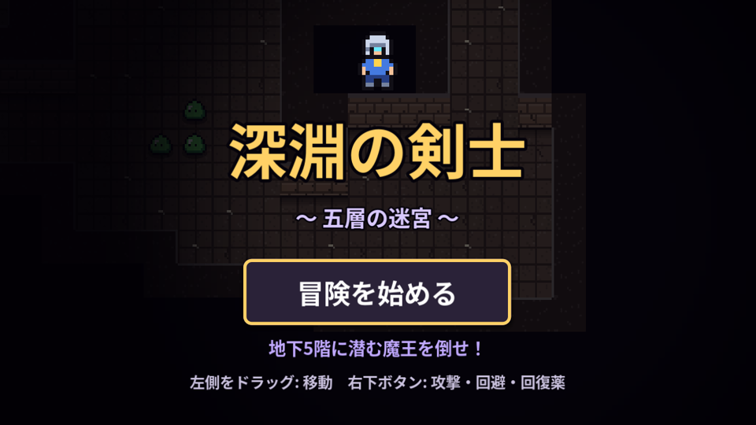
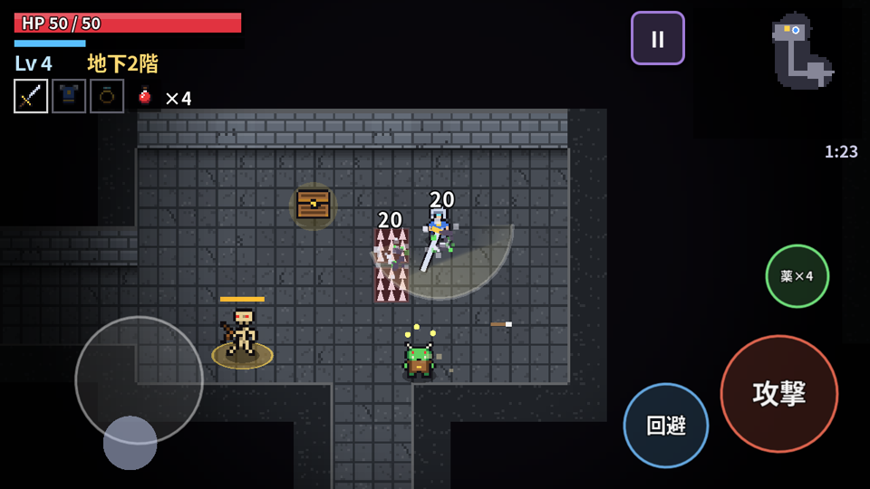
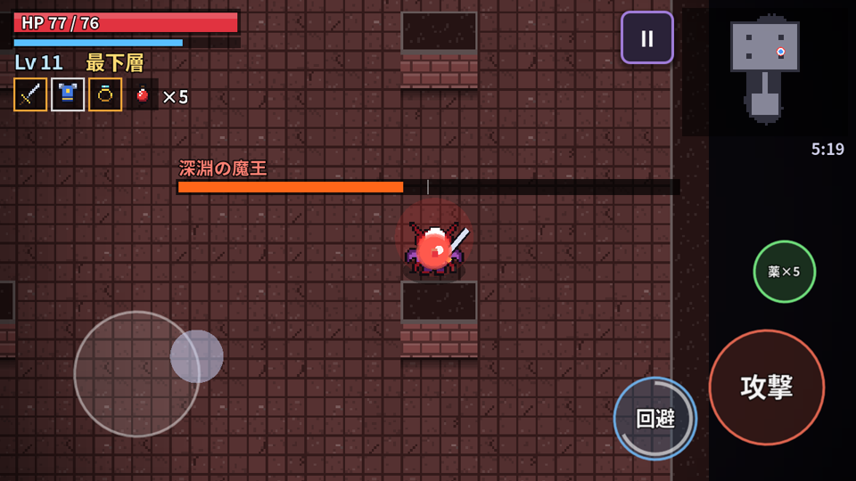
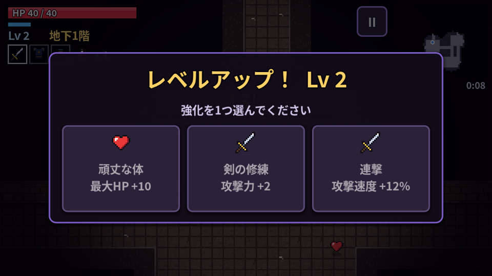
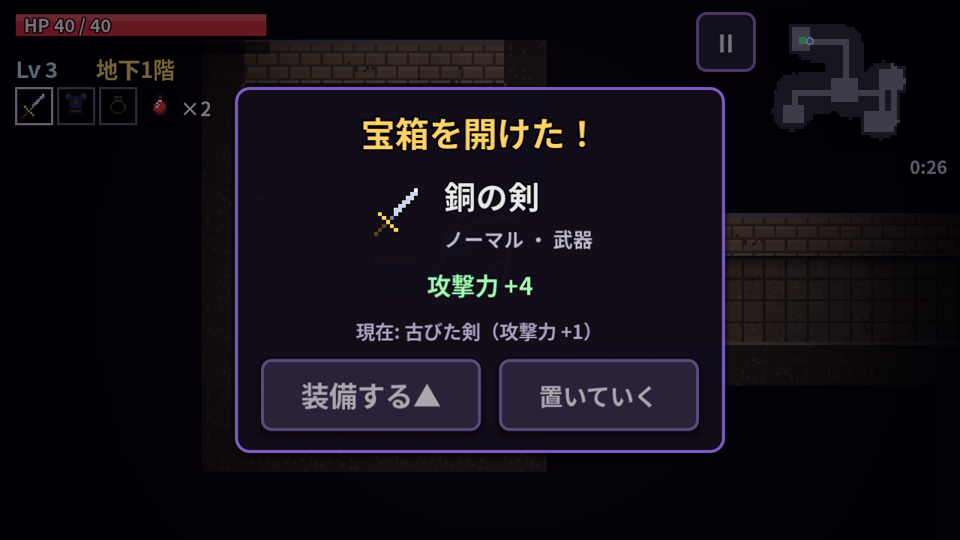
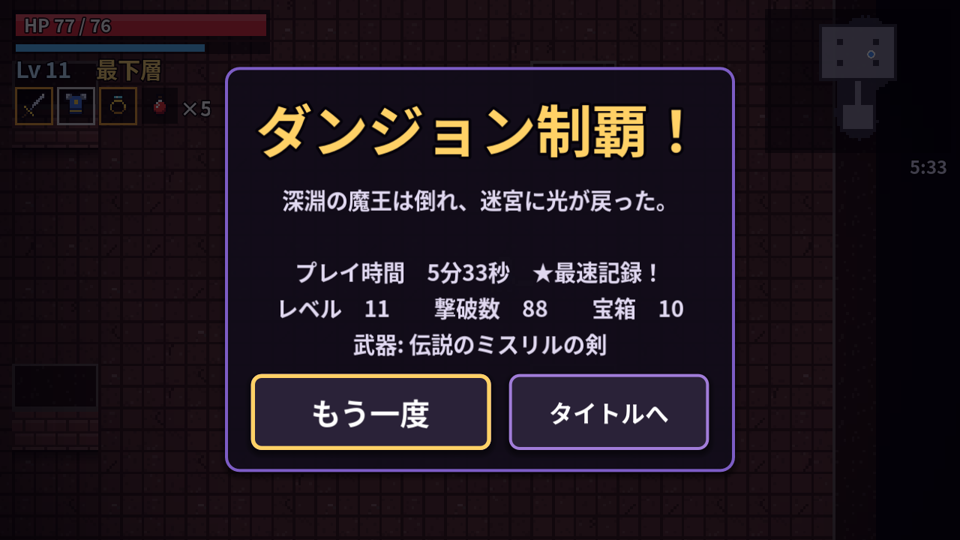

# 深淵の剣士 〜 五層の迷宮 〜

Godot 4.7 で作った 2D 見下ろし型ローグライク・アクションRPG です。
毎回ランダムに生成される5層のダンジョンを剣と回避で切り抜け、最下層に潜む「深淵の魔王」を倒せばクリア。
1プレイ約5〜10分。PCブラウザでもスマホブラウザでも遊べます。

## ▶ 今すぐ遊ぶ

**https://ferrarissound-design.github.io/dungeon-rogue/**

（スマホは横持ち推奨。縦持ちでも遊べます。初回読み込みは約40MBのダウンロードがあります）

| タイトル | 探索と戦闘 | ボス戦 |
|---|---|---|
|  |  |  |
| レベルアップ | 宝箱 | クリア |
|  |  |  |

## 遊び方

1. 「冒険を始める」で出発。各階のどこかにある **光る階段** を探して下の階へ。
2. 敵を倒すと経験値がたまり、**レベルアップ** で3つの強化から1つを選べます。
3. **宝箱** を開けると武器・防具・装飾品が手に入ります。今の装備と比べて「装備する」か「置いていく」かを選択（▲は今より強い印）。
4. 回復薬は敵がときどき落とします。HPが減ったら使いましょう（最大HPの50%回復）。
5. 地下5階（最下層）の **深淵の魔王** を倒せばダンジョン制覇！ HPが0になるとゲームオーバー。
6. 1つの階に長く留まると、画面に階段の方向を示す矢印が出ます。
7. 地下2階からは **トゲ罠** が出現。床からトゲが出る前に小さく予兆が出ます。回避（ローリング）中は無敵なので転がって抜けられます。
8. 金色のオーラをまとった **強敵** は体力・攻撃力が高い代わりに、経験値が3倍で回復薬を必ず落とします。

## 操作方法

| 操作 | スマホ（タッチ） | キーボード | ゲームパッド |
|---|---|---|---|
| 移動 | 画面左側をドラッグ（バーチャルスティック） | WASD / 矢印キー | 左スティック / 十字キー |
| 攻撃（3段コンボ） | 右下「攻撃」ボタン | J / Z / スペース | A / X |
| 回避（ローリング・無敵時間あり） | 「回避」ボタン | K / X / Shift | B / R1 |
| 回復薬 | 「薬」ボタン | Q / C | Y |
| 一時停止 | 右上 ‖ ボタン | Esc / P | Start |

- 攻撃は近くの敵へ自動で向きます。3段目は強力なフィニッシュ。
- 剣で敵の弾を **かき消す** ことができます。
- 移動しながら攻撃・回避ができます（マルチタッチ対応）。

## 主な機能

- **毎回変わるダンジョン**: 部屋＋通路をランダム生成（最小全域木＋ループ通路）。全シードで階段まで到達可能なことを自動テストで確認。
- **5つの階層テーマ**: 階ごとに色・雰囲気が変わり、敵も強くなります。
- **6種類の敵AI**
  - スライム: 跳ねながら追ってくる
  - コウモリ: ふらふら飛び、急に突進
  - 骸骨弓兵: 距離をとって狙い撃つ
  - 突撃オーク: 溜めてから突進（壁にぶつかると気絶）
  - 闇の魔術師: 追尾弾を放ち、近づくとワープで逃げる
  - **深淵の魔王（ボス）**: 弾幕リング・扇状弾・突進・手下召喚、HP半分で激昂して螺旋弾幕と跳躍叩きつけ
- **強敵（エリート）**: 地下2階以降、金色のオーラをまとった強化版の敵が出現
- **トゲ罠**: 周期的に飛び出すトゲ。ローリングの無敵時間ですり抜けられる
- **剣の3段コンボ＋ローリング回避**（無敵時間・クールダウン表示つき）
- **宝箱と装備**: 武器・防具・装飾品 × 3段階のレア度（ノーマル/レア/伝説）、ランダムな能力値
- **レベルアップ**: 11種類の強化（最大HP・攻撃力・防御・速度・会心・攻撃速度・リーチ・回避短縮・自然回復・吸血・回復薬）
- **視界と霧**: 周囲だけ明るく、探索した場所がミニマップに記録されます
- 効果音とBGM（すべてプログラムで合成）、ヒットストップ・画面揺れ・ダメージ数字
- タイトル / ゲームオーバー / クリア画面（クリアタイム・ベスト記録を保存）
- 一時停止メニュー（現在のステータス表示）

## 開発者向け

- 環境構築: [SETUP.md](SETUP.md)
- 書き出し（Web/Windows/Linux → docs/ へコピー）: `bash tools/build_all.sh`
- 自動テスト一式: `bash tools/test_all.sh`
- 画像・コードはすべて自作（スプライトは `scripts/art.gd` 内の文字アートから生成）。フォントは Noto Sans JP（SIL Open Font License、`fonts/LICENSE-NotoSansCJK.txt`）をサブセット化。

## ファイル構成

```
project.godot / main.tscn
scripts/main.gd    状態管理・入力・テスト用オプション
scripts/game.gd    ゲーム世界（プレイヤー・戦闘・描画）
scripts/dungeon.gd ダンジョン生成
scripts/enemy.gd   敵AI・ボス
scripts/items.gd   装備・強化の定義
scripts/art.gd     ドット絵・タイル生成
scripts/hud.gd     HUD・ミニマップ
scripts/ui.gd      タイトル・メニュー画面
scripts/touch.gd   タッチ操作
scripts/sfx.gd     効果音・BGM合成
scripts/bot.gd     自動プレイ（テスト用）
docs/              GitHub Pages 公開用 Web ビルド
tools/             セットアップ・ビルド・テスト用スクリプト
```
